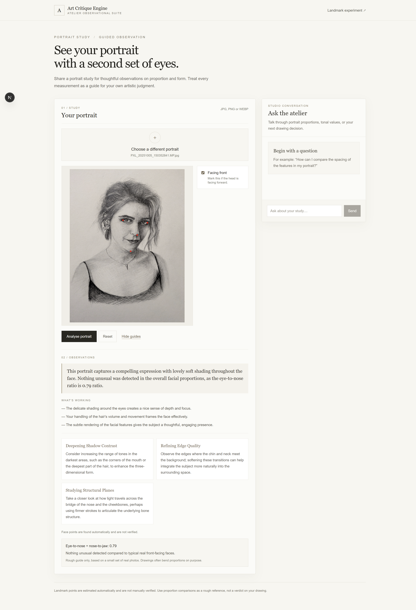

# Art Critique Engine

Upload a portrait drawing and get written feedback, with guide lines drawn on top of your drawing and a few measurements calculated in code.

I draw portraits, and sometimes a drawing looks off to me even after I have stared at it for a long time, without my being able to say why. This app is my attempt at a second look. You upload a drawing, and it finds four face points, measures the head tilt and one proportion in code, and decides in code whether that proportion looks unusual compared with 9 real front-facing photos. An AI then writes the feedback.

It is a personal tool so far. Nobody else has tested it, so I cannot say who else it helps. Next I want to try comparing a drawing with its reference photo and find out whether the current tools can do that. That is not built yet.

> **Status:** a working app that runs locally. Weeks 1 to 4 are done and their gates are passed, and Week 5 (hardening and tests) is mostly done, with 37 automated tests in 9 files. It is not deployed and has no rate limiting yet, so it is not ready for a public link. Sections marked *Planned* are not built yet.

   

The goal is feedback and insight, not fixing the drawing for you.

## What it does

1. You pick a portrait drawing.
2. The browser finds four key points on the face (both eyes, nose, jaw).
3. You tick a box if the head faces front. It is unticked by default.
4. The points are drawn over your image as guide lines (eye line, midline, tilt). You can show or hide them.
5. The server measures the head tilt and one proportion (eye-to-nose compared with nose-to-jaw). It compares the proportion with a rough guide built from real faces and picks one of four labels. This is done in code, not by the AI.
6. An AI writes feedback: a short summary, what is working, and a few suggestions. It can look up the measurements through a tool, but it does not decide the label.
7. A ratio card shows the label from the code. The critique shows the words from the AI.

## Quick facts

| Item | Detail |
|---|---|
| Stack | Next.js (App Router), React, TypeScript, Tailwind, Zod, Vercel AI SDK, Google Gemini, MediaPipe, Canvas |
| Face points | Found in the browser. The image is not uploaded for that step. |
| Feedback | The image and four points go to this app's server and on to Google's Gemini service. The app does not store the image. |
| Chat | A small drawing-advice chat. Only the typed messages go to the server and on to Gemini, never the image. It cannot see the drawing or the critique yet. |
| Verdict | Decided by code. The AI only puts it into words. |
| Honest limits | The guide is built from 9 real front-facing photos. It is a rough guide, not a standard. See [Known limitations](#known-limitations). |

## Running it locally

Versions in use: `ai` 7.0.122, `@ai-sdk/google` 4.0.85, `@ai-sdk/react` 4.0.125, `@mediapipe/tasks-vision` 1.0.1 (exact pin).

1. Install with `npm install`.
2. Put your Google key in `.env.local` as `GOOGLE_GENERATIVE_AI_API_KEY`. It stays on the server and is never sent to the browser. Do not commit this file.
3. Nothing to download for face finding. The MediaPipe Face Landmarker model file is in the repo at `public/models/face_landmarker.task`, and the MediaPipe wasm files are in `public/mediapipe/wasm`.
4. Start with `npm run dev`.

To run the automated tests, use `npx vitest run`. See [Automated tests](#automated-tests).

*(There is no deploy link yet. See [Known limitations](#known-limitations).)*

## How it works

```text
BROWSER                                   SERVER                                 GOOGLE
-------                                   ------                                 ------
pick an image
check type and size
find face points (MediaPipe)
  no face, or bad points
  -> stop here, ask for another image
draw the guide lines (canvas)
student ticks "head faces front"
  (default: unticked)
send image + points + size + frontFacing ->
                                          check file, points and fields
                                          (400, 413 or 415 if wrong)
                                          measure tilt and ratio (code)
                                          judge the ratio (code)
                                            -> one of 4 labels
                                          build the measuring tool with the
                                            list allowed for that label
                                          ask Gemini for a critique -----------> may call the tool
                                          run the tool, return the value ------>
                                                                                 writes the critique
                                          check the reply's shape <-------------
                                          (502 if the shape is wrong, or if
                                           "unusual" comes back with no
                                           suggestions)
check the reply's shape again <---------  send { critique, ratio, judgementRatio }
card shows the label from CODE
critique shows the words from the MODEL
```

### The four labels

| Label | When | What the screen says |
|---|---|---|
| `not-front-facing` | The box is unticked | The proportion check was skipped. The app makes no claim. |
| `not-measured` | The ratio could not be calculated | The proportion could not be measured for this image. |
| `unusual` | Ticked, and the ratio is outside the guide band | Unusual compared to real front-facing faces. This could be the angle or the style, not necessarily a mistake. |
| `nothing-unusual` | Ticked, and the ratio is inside the band | Nothing unusual detected compared to typical real front-facing faces. |

The number and the "rough guide" line are shown only for `unusual` and `nothing-unusual`.

## The chat

The page also has a small chat, "Ask the atelier", for general drawing questions such as "what is a value study?".

**What it cannot do yet.** It cannot see the drawing, the measurements, the label or the critique, because the browser sends it only the chat messages. So it cannot explain or clarify a critique. Connecting them is planned: the browser would send the critique and the label as extra context, and the server would check that context the way it checks the critique request.

**What the code enforces, and what is only asked.**

| Rule | How it is held |
|---|---|
| A request has 1 to 40 messages. Each has the role `user` or `assistant`, and each text part is at most 4000 characters. | Enforced: `chatRequestSchema` checks it, and the route answers 400 if it fails. |
| The conversation must end with a message from the student. | Enforced: `selectRecentMessages` returns `null` otherwise, and the route answers 400. |
| Only the last 10 messages are used, and the first message the model sees must be from the student. | Enforced: `selectRecentMessages` takes the last 10 and drops leading messages that are not from the student. Because the conversation ends on a student message, the 10th from the end is always an assistant message, so the model usually gets 9. |
| A reply is at most 400 tokens. | Enforced: `maxOutputTokens`. |
| Stay on drawing and art practice, answer in plain text in 100 to 200 words, never claim that Analyse compares the drawing with the student's own reference photo, and treat the student's text as a question, not as instructions. | Only asked, in the chat instructions. A request, not a guarantee. |

**Errors.** The chat streams its reply, so a provider failure arrives as an event inside a response that already has status 200, not as an error status. The SDK hides the provider's message by default. The chat shows its own fixed text and a Retry button, and the server logs only a short summary.

## Tools used, and why

| Tool | What it does here | Why this one |
|---|---|---|
| Next.js (App Router) | The website and the server routes | Frontend and backend in one project |
| React + TypeScript | The interface | Typed code catches mistakes early |
| Tailwind CSS | Styling | Fast, consistent styling |
| Vercel AI SDK + Google Gemini | Streaming chat text, and the written critique as a checked object, with a measuring tool the model can call | Free tier, and the SDK handles streaming, structured output and tool calls for us |
| Zod | Checks data while the app is running | TypeScript only checks code, not data that arrives later |
| MediaPipe Face Landmarker | Finds face points in the browser | A tool built for locating points, unlike a language model |
| Canvas API | Draws the guides over the image | Direct control over drawing |

## Key decisions (the "why")

### Security and structure

**The AI key stays on the server.** The browser talks to our own route, and only that route talks to the AI provider. Anyone can read what a browser sends, so a key there would be public.

**Checks happen in two places.** The browser checks a file's type and size to give instant, friendly feedback. The server checks again, because the browser can be bypassed. The browser check is for the user. The server check is the real protection.

**The limits live in one file.** The allowed file types and the size limit are defined once and used by both the browser and the server, so they can never disagree.

**The AI call lives in its own function.** The route only handles the web side: reading the request, running the checks, and choosing status codes. A separate function makes the AI call and throws if anything goes wrong, and the route decides what the user sees. This also lets the AI step be tested without sending a web request.

### Data and checks

**Zod on top of TypeScript.** TypeScript checks what I wrote, before the app runs. It cannot see data that arrives while the app runs, such as an AI or MediaPipe result. Zod checks that data at the door. Zod checks the shape and range of a value, not whether it is true. A point in the wrong place but in the right format will still pass.

**Positions are stored as fractions.** A point is saved as "35% across, 31% down", not "pixel 350". A pixel number only makes sense at one image size. A fraction works at any size, and the drawing step just multiplies it by the displayed width or height. Measurements use the natural image size in pixels. Drawing uses the displayed size.

**"Left" and "right" mean the viewer's side of the screen.** `leftEye` is the eye on the left of the screen (the smaller x value), which is the subject's right eye. I chose this because the drawing code only deals with screen positions. I checked it against real output: on a photo and on a drawing, the point I call `leftEye` always had the smaller x value.

**Tiny overshoots are tidied, big ones are rejected.** The point-finding tool can report a position slightly outside the image, for example when a chin is cut off. A value up to 0.05 past the edge is moved onto the edge. Anything further is left alone and rejected by the strict check, so a clearly broken value is never hidden.

**Checks happen in two stages.** First, each number must be between 0 and 1. Then the points must make sense together (the left eye must be to the left of the right eye). The second stage catches swapped points that pass the first.

**A failure is returned, not thrown.** "No face found" and "face found but unreadable" are normal outcomes for a drawing app, not crashes. The code returns a clear reason, and the screen decides what to show. Neither case offers Retry, because the same drawing would give the same result.

**A form field that arrives as text is parsed carefully.** `frontFacing` is checked as `z.enum(["true","false"]).transform(v => v === "true")`. The shortcut `z.coerce.boolean()` turns the text `"false"` into `true`, because any non-empty string counts as true. A missing field is treated as `"false"`, which means the app makes no claim.

### Finding the face points

**Face points are found in the browser, once per page.** The point-finding engine loads on the first click and is reused for later clicks, so we don't pay the loading cost every time. The browser turns the file into a loaded image, finds the points, checks them, and only then sends the image and the points to the server. If no face is found, no request is sent at all.

**A specialist finds the points, the AI writes the words.** A language model can sound confident while being wrong about exact positions, and nothing in our code can check it. MediaPipe is built to locate face points. The AI is used for what it is good at: writing feedback. The AI is not asked to judge whether a point is in the right place.

### The critique step

**The critique is a structured object, not free text.** The AI returns a short summary, a list of what is working (up to 3), and a list of suggestions (up to 5), each with a title and a detail. If it returned one paragraph, the screen would have to guess where the summary ends and the cards begin by hunting for words like "First" and "Second". That breaks the moment the AI words things differently. With named fields, the screen simply reads `summary`, `working` and `suggestions`.

**Zod checks the AI's reply too, even though it is only words.** TypeScript cannot see what the AI sends back while the app runs. Without a check, a reply where `suggestions` is a plain string instead of a list would crash the screen. If any part is wrong, the whole reply is rejected, not just that part. Zod checks the shape of the critique, not whether it is true or useful. The reply is checked twice: on the server before it is sent, and in the browser before it reaches the screen.

**There are checks before and after the AI call.** Before the call, the file, the landmark numbers and the form fields are checked on the server, because anyone can call the server directly and skip the browser. After the call, the AI's reply is checked. The input checks run first because the call costs money and time, and the numbers become part of the AI's instructions, so bad input should never reach it.

**Some rules in the reply check are also sent to the AI provider.** Count and length rules (such as "at least 1" or "at most 5") are passed to Gemini as part of the required shape. In a test, an impossible rule made Google reject the request itself, which showed up as a 500 on our side. Custom checks run in our own code instead. So these rules need to be realistic.

**The AI's "this point may be off" warning was removed after testing.** At first the AI could add an optional warning naming a point it doubted. In testing it was not reliable:
- On a real photo where I checked the jaw point by hand, it was within about 12 px of the chin on a 4624 px tall image (about 0.26% of the height). The old prompt still produced a warning in 3 of 3 runs. That is a false alarm.
- After softening the prompt, the photo gave no warning in 3 runs, but the drawing still gave one in 5 of 6 runs, on points I had checked and found accurate.
- Earlier, with a deliberately wrong jaw point, the warning appeared in only 1 of 4 runs and often pointed the wrong way.

A signal that is wrong in both directions tells the user nothing, and a confident amber box makes them doubt good points. So the field was removed from the schema, the prompt and the screen. A fixed note, "Face points are found automatically and are not verified", stays visible. The overlay lets the user judge the points themselves.

### Code decides the verdict (Week 4)

| Decision | Why |
|---|---|
| The code decides the verdict. The model only words it. | A model-written verdict could contradict the measurement and still pass Zod, because Zod checks shape, not truth. |
| The verdict sits next to the critique in the response, not inside the schema the model fills. | Anything the model fills is the model's call. |
| Wording is "unusual compared to typical real front-facing faces", never "wrong". | Stylized drawings break proportions on purpose. |
| Inside the band means "nothing unusual detected", never "your proportions are good". | The band is wide and built from few photos. |
| Head pose comes from the student's choice, default unticked. | A model guess cannot be verified. Code-measured pose is a possible later upgrade. Unticked means the app makes no claim. |
| The measuring tool has a per-state list of allowed measurements (`ALLOWED_MEASUREMENTS`), built in code. | A prompt is a request, not a guarantee. The model quoted pixel distances after being told not to. Now it never receives those numbers for a head that is not front-facing. |
| The tool is built for each request. | Two requests at the same time never mix data. |
| `judgeRatio` checks pose first, then a missing ratio, then the band. | A missing ratio would be read as 0 in a comparison and look "unusual". |
| Empty `suggestions` and empty `working` lists are allowed. | Forcing at least one item makes the model invent praise or advice. |
| An empty list is shown as "No suggestions this time. That is not a verdict that the drawing is perfect." | The code only checks one ratio and the tilt, not value, hands, hair or composition. |
| `unusual` with no suggestions is rejected (502). | The code found something worth a look, so an empty critique contradicts it. |
| An upstream 503 (provider busy) maps to our 503 with an honest message, and the browser shows Retry. | It is temporary, so retrying makes sense. A 429 gets its own wording, because retrying will not fix a daily limit. |

## Real-face data and the rough guide

13 real photos were measured with the app's own landmarks. Photos marked not front-facing (slightly down, slightly turned, slightly tilted, slightly up with the jaw covered by fingers) stay in the log but are left out of the range.

- Front-facing photos counted: **9**
- Range: **0.49 to 0.94**, median about **0.67**
- Guide band used in code: **0.39 to 1.04**. This is the range widened by 0.10 on each side, because slight pose changes slip past the student's choice and the sample is small.
- Measurements were repeatable: a tight crop of one photo gave 0.51 against 0.49 for the full shot, so face size is not the cause of the spread.
- Real faces still vary about 2x between the lowest and highest ratio. The causes (pose, expression, camera distance) are **not** tested, and none is claimed.
- The range moved when photos were added (lowest 0.49 to 0.32 with ten, back to 0.49 after one photo was excluded). Treat the edges as unstable. This is a rough guide, not a standard. Ten photos was a target chosen for this project, not a statistical standard.

## What Week 5 added

Week 5 was about making the app behave like software a small team could ship: a stranger can use it, trigger a common error, recover from it, and understand what is happening.

- **Failure handling, checked row by row.** Each common failure was traced through the code and tried in the browser where possible: no image, wrong file type, file too large, network interruption, double click, provider errors, bad model output and a canvas failure. The results are in the table in the next section and in [Week 5 checks](#week-5-checks).
- **Honest provider errors.** A provider 429 and a provider 503 get their own wording. Everything else, including our own wrong key, becomes a generic 500. These errors show Retry, but nothing retries by itself.
- **Safe logging.** The critique route logs only a status and a short error name, because a provider error can carry the uploaded image.
- **The chat made honest and safe.** It checks the request, answers 400 for a conversation that does not end with the student's message, keeps only the last 10 messages, caps the reply at 400 tokens, logs only a short summary, and its instructions no longer claim that it can see the drawing. See [The chat](#the-chat).
- **A canvas fallback in three layers.** The drawing helper throws instead of failing silently when it cannot get a canvas context. The overlay catches that and shows a message. An error boundary around the overlay catches anything thrown while React draws it.
- **MediaPipe pinned and self-hosted.** Exact version 1.0.1, with the wasm files in `public/mediapipe/wasm`, so the app no longer depends on a CDN's "latest".
- **Automated tests.** 37 tests, described in [Automated tests](#automated-tests).
- **Smaller fixes found on the way.** `judgeRatio` treats NaN and Infinity as `not-measured`. Retry no longer hides the guides. The size message states the limit in MB. A file is validated the moment it is picked, and the previous photo's state is reset.

## What the user sees when something goes wrong

| Situation | What happens |
|---|---|
| Wrong file type or file too large | Stopped in the browser, with a message and a "Choose another image" option. Nothing is uploaded. |
| Same problem, but sent directly to the server | The server rejects it with a clear error code (400, 413 or 415). |
| No face is found in the image | A message asking for a clearer or more complete portrait, and "Choose another image". No request is sent. No Retry, because the same image gives the same result. |
| A face is found but its points fail the check | A message and "Choose another image". No request is sent. |
| The image file cannot be read in the browser | A message and "Choose another image". The same file will fail again, so there is no Retry. |
| The point-finding engine fails to load | A friendly message and a Retry button. The real error is logged in the browser console. |
| Landmark data or form fields are missing, broken, or fail the check, sent directly to the server | The server rejects it with a 400 and a fixed message. Details are logged on the server only. |
| The AI's reply does not match the expected shape, or says `unusual` with no suggestions | A fixed friendly message and a Retry button (502). The AI may give a valid reply next time. The raw reply is logged on the server and never shown. |
| The AI provider is busy or rate-limited | A 503 with an honest message and a Retry button. A rate limit gets its own wording, because retrying will not fix a daily limit. |
| The AI service fails for another reason (for example a wrong or expired key) | A fixed friendly message and a Retry button (500). The real error is logged on the server. |
| The browser receives a reply that fails its own check | A fixed friendly message and a Retry button. The details are logged in the browser console. |
| Server problem | A fixed friendly message and a Retry button. The server's own error text is never shown, because it could reveal internal details. |
| No connection | A friendly message and a Retry button. |
| The guides cannot be drawn on the canvas | If something throws while React draws the overlay, an error boundary shows the photo with "The guides can't be shown for this image. You can still analyse it." If the drawing call fails afterwards, a message over the photo says the guides could not be drawn and the critique is not affected. The page does not crash, and a new photo resets the boundary. |
| Analyse is clicked again while a request is running | The button is disabled and reads "Working…". Only one request is sent. |
| A chat request is broken, or the conversation does not end with the student's message, sent directly to the server | The server answers 400 with a fixed message. |
| The chat provider is busy or fails | The chat shows "Something went wrong. Please try again." and a Retry button. A real 503 from Gemini was seen during testing. The server logs a short summary only. |

Rule of thumb: problems with the user's input (4xx, or caught in the browser) are the same every time, so there is no Retry. Problems on our side, at the provider or on the network (5xx) can change on a second try, so there is a Retry.

## Privacy

Finding the face points runs in the browser, so the image is not uploaded for that step. The point-finding engine (its wasm files) and the model file are both served from this site, so no outside CDN is contacted for them, and neither receives your image.

The feedback step does send data out. The browser sends the image and the four points to this app's server, which passes them on to Google's Gemini service to write the feedback. This app does not store the image. Google handles the image under its own terms for the plan being used. Before sharing the app publicly, check Google's data terms for the plan in use.

So the app does not claim the image never leaves the device.

The chat sends only the typed messages to the server, and on to Gemini. It does not send the image, and this app does not store the messages.

Both AI routes (the critique and the chat) log only a provider status and a short error name, never the request body. The reason: an error object from the AI provider can carry the request body, which holds the uploaded image, and a log that prints the whole object would leak it. A unit test plants fake image data in an error and checks that it does not appear in the logged summary.

## Known failure modes

Seven ways the app falls short, taken from my own testing.

### 1. No face found on non-frontal drawings
- **What I saw:** 3 of 13 images (a 45-degree side view, a side view with no tilt, and a face-and-body pose with closed eyes) showed "We couldn't find a face."
- **Why:** MediaPipe returned an empty list, so `extractLandmarks` returned `{ ok: false, reason: "no face detected" }`. A side view is the likely cause. The face-and-body image might also be affected by face size or closed eyes.
- **What the app does:** It stops in the browser and sends nothing to the server. It shows a message and "Choose another image", with no Retry.

### 2. The wording changes on every click
- **What I saw:** The same image gives similar advice in different sentences each time.
- **Why:** The model picks its words with some randomness. One run passing is not proof.
- **What the app does:** Nothing yet, so this is a documented limit. Possible fixes are remembering the critique per file with an explicit "Regenerate" button, or lowering the randomness (to be checked in the docs first). Repeatable is not the same as correct.

### 3. "It always gives suggestions" (addressed in Week 4)
- **What I saw (Week 3):** A drawing with correct proportions could still get several things to fix, so the user might think something is wrong.
- **What changed:** Empty lists are allowed, there is a "what's working" field, and the verdict comes from code.
- **Limit that remains:** The code can only judge one ratio against a wide band and the tilt. It cannot say a drawing is good.

### 4. The student's front-facing choice is coarse
- **What I saw:** Slightly turned or tilted heads still get ticked "front", and a small pose change moved one ratio by about 50%.
- **What the app does:** The band is widened for this reason. A code-measured pose is a possible later upgrade.

### 5. A prompt is a request, not a guarantee
- **What I saw:** The model quoted pixel distances after the instructions said not to.
- **What the app does:** Rules that must hold are enforced in code (the per-state tool list and the response check).

### 6. Provider limits and outages
- **What I saw:** 503 (busy) and the free-tier limit (429) came from Google during testing, not from the app.
- **What the app does:** It answers 503 with a Retry button and an honest message. Waiting for the daily reset, or switching model, is the workaround while testing.

### 7. Face points are found automatically and not verified
- **What I saw:** A jaw covered by fingers produced a ratio that was excluded from the data.
- **What the app does:** A note on the screen always says the points are not verified, and the overlay lets the user judge them.

## Known limitations

- **Drawings are not photographs.** The point-finding tool was trained mostly on real photos. Stylised, rough or unusual drawings may get points in the wrong place, or no face at all.
- **A point can be wrong and still look valid.** Validation checks form, not truth. The overlay lets the user judge the points, but the app does not verify them. The jaw point was checked by hand on one photo (about 12 px off on a 4624 px tall image) and found accurate on one drawing. No systematic check of the nose point has been logged.
- **The rough guide is small.** It comes from 9 real front-facing photos. Its edges moved when photos were added. It says what is unusual among those faces, not what is correct.
- **The check covers one ratio and the tilt.** It says nothing about value, hands, hair or composition.
- **The critique can be wrong and still look valid.** The check on the AI's reply only confirms its shape. A confident sentence about a nose the drawing does not have passes just as easily as a true one.
- **The critique can be generic.** Some suggestions are specific to the drawing (for example, shadow depth where the jaw meets the neck). Others would fit almost any face. Nothing in the code can tell them apart, so this needs a human check.
- **The AI can quote a number wrongly.** It gets measurements through the tool, but nothing yet checks that a number in the critique matches the true value. A log-only check is planned.
- **Text inside an image could try to instruct the AI.** The instructions tell it to treat such text as part of the drawing, but that is a request, not a guarantee.
- **The length of each suggestion is requested, not enforced.** The prompt asks for short text, but the check does not limit length, so a very long suggestion could break a card.
- **Very small overshoots are adjusted.** A point up to 0.05 past the image edge is moved onto the edge, so it is an approximation. Bigger overshoots are rejected. The 0.05 value is a starting guess still to be tested.
- **File type is checked by label only.** The browser's reported type can be faked. A file such as `notes.pdf` renamed to `notes.jpg` passes this check and is caught later, when the browser tries to load it as an image (a message and "Choose another image"). Checking the file's real contents is out of scope for now.
- **Mirrored, upside-down or strongly tilted faces** may fail the left-before-right check even when the points are correct.
- **A file of exactly 10 MB is accepted.** Only files over the limit are rejected. A test pins this.
- **One behaviour has no test.** Nothing checks that `UploadPanel` passes `key={previewUrl}` to the canvas boundary, which is what lets a new photo reset a boundary that has already failed.
- **The chat cannot see the drawing or the critique.** It gives general drawing advice only, and it is told to say so and to point the student to Analyse.
- **The chat's scope and length are requested, not enforced.** Code holds the request checks and the 400-token cap. Staying on topic and answering in 100 to 200 words are only asked in the instructions.
- **The chat forgets older messages.** Only the last 10 are used, and the model usually sees 9.
- **The chat scrolls to the bottom on every update.** A student who scrolls up while a reply streams is pulled back down.
- **No rate limiting yet.** Neither AI route (the critique and the chat) has a limit per visitor. This needs adding before the app is shared with a public link.

## What is built, and what is planned

**Built**
- Face points found in the browser, checked and shown as guide lines on a canvas (Weeks 1 to 4)
- Geometry helpers in `lib/geometry.ts`: tilt, distances, midpoints and the eye-to-nose over nose-to-jaw ratio
- One real tool the model can call, with its full lifecycle (model asks, app runs it, model writes)
- Verdict decided in code, with four labels and a ratio card
- A critique with "what's working", suggestions, and an honest empty state
- Failure handling for the common cases, with Retry or "Choose another image" (see the table above), including a fallback if the canvas fails
- MediaPipe pinned to 1.0.1 and served from this site, not from a CDN
- 37 automated tests (see [Automated tests](#automated-tests))

**Planned** (calculated in code, not by the AI, so the results can be checked)
- **Week 5, still to do:** a performance pass (see the resize item below), live checks of the 503 and 429 paths, and an end-to-end browser test with the API route mocked
- **Value map:** the drawing shown in 4 shades, plus its darkest-to-lightest range, calculated in the browser
- **Reference comparison (stretch):** compare a drawing's ratios with the photo it was drawn from
- **Code-measured head pose:** MediaPipe has a facial transformation matrix output. It is untested on drawings, so the MediaPipe docs come first.
- **A check that numbers in the critique match the true values** (log-only at first)
- **Connect the chat to the critique:** send the critique and the label as context, checked on the server
- **Rate and cost limiting** on both AI routes
- **Resize the image in the browser before upload**

**Deliberately out of scope for now:** saving users' images or accounts, a database, and extra AI frameworks. These are not needed for the core feature, so they are on a "later" list.

## Decisions still open

- Whether 0.05 is the right overshoot tolerance. The 13-image test log does not record overshoots.
- Whether to limit the length of each suggestion in the check, instead of only asking in the prompt.
- Whether to add plain-code sanity checks on the points (for example, the nose is below the eyes and the jaw is below the nose) to catch gross errors.
- Whether to remember the critique per file and add a Regenerate button, or lower the AI's randomness.
- Whether the guide band should be rebuilt from more photos, and whether the front-facing choice should come from measured pose instead of the student.

## Not yet verified

Things written into the code or this README that I have not confirmed by running them:

- **Provider busy (503) and limit (429) handling.** Written after seeing a real 503 from Gemini and hitting the free-tier limit. The Retry path and the separate 429 wording have not been re-tested end to end.
- **`unusual` with an empty suggestions list returning a 502.** Not yet triggered live.
- **The ticked photo with ratio 0.80.** That run happened before the per-state tool list was added, and I did not read the label in the Network tab. It needs one re-run.
- **That logs never contain image data.** Both AI routes log only a provider status and a short name. This is covered by a unit test and was checked once with a wrong API key. A full audit of every log call has not been done.

## Automated tests

Run them with `npx vitest run`. They live in `__tests__/` and make no real AI calls, so they spend no quota. 37 tests in 9 files:

| File | Tests | What it checks |
|---|---|---|
| `ratioGuide.test.ts` | 9 | `judgeRatio`: the band edges (0.39 and 1.04) count as inside, and NaN and Infinity give `not-measured` |
| `schema.test.ts` | 5 | `frontFacing` accepts `"true"` and `"false"`, and rejects `""`, `"banana"` and `"TRUE"` |
| `errors.test.ts` | 6 | `getProviderStatus` for a 429, a 503 inside a retry error, no status, a plain error and a string, plus the test that fake image data planted in an error never appears in the logged summary |
| `upload.test.ts` | 3 | `validateFile`: a file over the limit is rejected with the size message, a wrong type is rejected with the type message, and a file of exactly the limit is accepted |
| `CanvasBoundary.test.tsx` | 2 | A child that throws shows the fallback, and a normal child shows its content |
| `uploadPanel.test.tsx` | 2 | A second click on Analyse is ignored while the upload is in flight, and while the image is being analysed. The face engine, image loading, landmark extraction and `fetch` are replaced by fakes. |
| `chatSchema.test.ts` | 5 | `chatRequestSchema`: a real body copied from the browser passes, a `system` role is rejected, 41 messages are rejected, exactly 40 are accepted, and a message with no parts is rejected |
| `chat.test.ts` | 4 | `selectRecentMessages`: it returns `null` when the last message is not from the student, it keeps only the most recent messages, and it drops leading messages that are not from the student |
| `sanity.test.ts` | 1 | The test runner works |

Apart from the runner check, every rule covered here was checked by temporarily breaking the code (for example, changing `>` to `>=` in the size check) and confirming that the intended assertion failed, then restoring the code.

**Not covered yet:** the chat route itself (its 400 answer and the message cut were checked by hand with `curl` and a temporary log, not by a test), an end-to-end browser test (Playwright with the API route mocked is planned), a test of the critique route itself (mocking the AI call and asserting 429, 503 and 500 is a possible next step), and the `key` behaviour described in [Known limitations](#known-limitations).

## Test record

### Landmark pipeline (first checks)

| Image | Faces found | Result | Notes |
|---|---|---|---|
| Clear photo | 1 | Landmarks OK | Chin sits below the nose, as expected |
| Image with no face | 0 | No face found | Handled as a normal outcome |
| Upright portrait drawing | 1 | Landmarks OK | Eyes, nose and mouth visible. Chin sits below the nose. |

"Landmarks OK" means the points passed the checks, not that they were confirmed by eye on the image.

### Image test: 13 pencil drawings

| Measure | Result |
|---|---|
| Images tested | 13 |
| Critique shown | 10 |
| No face found | 3 (all side views or a face-and-body pose) |
| Critique judged specific to the drawing | 10 of 10 (one rater: me) |
| Critique claiming a point is wrong | 0 of 10 |

What I noticed:
- Most critiques mention the eye line, the nose bridge and the tilt of the head.
- Many also mention the shading where the jaw meets the neck, or hair shadows.
- A drawing that included the body got comments on the proportions of the hand and arm.
- The test set is narrow: all pencil drawings, one rater, no cartoons, glasses or two faces. A wider set is still to be done.

### Critique step (Week 3)

| Run | Result | Notes |
|---|---|---|
| Real photo, jaw hand check | Jaw point 2 px (x) and 12 px (y) from the chin | Image 3472 x 4624. Jaw (1842, 2477), chin by eye (1844, 2489). Accurate. |
| Photo, old prompt, 3 runs | Warning in 3 of 3 | False alarm on accurate points |
| Drawing, old prompt, 3 runs | Warning in 3 of 3 | |
| Photo, softened prompt, 3 runs | Warning in 0 of 3 | |
| Drawing, softened prompt, 6 runs | Warning in 5 of 6 | First run clean. The warning said the jaw was too low, but I checked by eye and the points are accurate. |
| Warning field removed | No type errors (`tsc` clean) | The AI still mentions the jaw and chin in suggestions, but none of the sampled critiques claimed a point was wrong. |
| Wrong API key | 500 | Fixed message shown. The real error appeared only in the server terminal. |
| Forced bad reply shape (test rule that always fails) | AI step fails its check | The route first returned 500 because the status code was wrong. It should be 502. Not re-tested since. |
| Impossible rule (`.min(5000)` on the summary) | 500 | Google rejected the request itself (400, invalid argument). Showed that count and length rules are sent to the provider. |
| Drawing with no face | Message shown, no request sent | Checked in the browser's network tab. |

"200" means the reply passed the shape check. It does not mean the critique was true.

### Verdict and ratio card (Week 4)

| What was tested | Result |
|---|---|
| Box unticked, real photo, ratio 1.38 | Label `not-front-facing`. The first run's critique quoted pixel distances despite the note. After the per-state tool list, it mentioned only the tilt. |
| Box ticked, same photo (1.38) | Label `unusual`. The critique said it was unusual and hedged with angle or style. No "wrong". Only tilt and ratio were used. |
| Box ticked, real photo, ratio 0.80 | The critique said nothing unusual was detected and did not call the proportions good. Run before the tool list change, label not read in the Network tab. |
| Ratio card, four states, hard-coded props | Number shown only for the two judged states. Rough-guide line only for those two. `not-front-facing` hides the number even when it is 1.38. |
| Critique view, empty lists, hard-coded props | Empty suggestions shows the scoped message. Both empty shows the summary and the message, no silence. |
| `unusual` with empty suggestions rejected (502) | Not yet triggered live. |
| Rate limit / provider busy | The free-tier limit was reached during testing. A model switch or waiting for the daily reset is the workaround. |

### Week 4 gate

- Overlay aligns at several image sizes: passed.
- Resizing keeps coordinates sensible: passed.
- Toggling the overlay triggers no extra API calls: passed (it only flips a boolean).
- One real tool works end to end and the lifecycle is explained: passed. Quiz 83% (5 of 6).

### Week 5 checks

| What was tested | Result |
|---|---|
| Wrong API key | The server terminal printed one line (`Critique failed: provider error: status 401, retryable false`). The real key was restored. |
| A `throw` inside the overlay's effect, no error boundary | Next's "This page couldn't load" replaced the page. |
| The same `throw`, with the error boundary | Only the image area changed. The rest of the page stayed. |
| A `throw` in the drawing helper, before Analyse | The photo alone, with no message. The message needs face points, and there are none yet. |
| The same `throw`, after Analyse | The overlay message appeared and the critique still showed. No `Uncaught` error in the console, only the logged `Canvas draw failed` line. |
| A `throw` while React draws the overlay (before and after Analyse) | The fallback message and the photo showed in both cases. |
| Double click on Analyse (two tests) | Each test went red when its guard was removed (`fetch` called 2 times, and `loadImage` called 2 times) and green when the guard was restored. |
| MediaPipe self-hosting | In the Network tab the wasm requests go to `localhost:3000/mediapipe/wasm/...` with status 200, and none go to a CDN. |
| Secrets | `git check-ignore -v` confirmed that `.env.local` and local tool config files are ignored by git. |
| Network interruption | Traced through the code (message, Retry, guides stay on after a retry). Not yet tested by cutting the connection. |
| Provider 503 and 429 wording, "unusual with no suggestions" (502) | Written and unit-tested for the status helpers, but not yet triggered live. |
| Chat, a normal conversation sent with `curl` | `200` with `content-type: text/event-stream`. The reply arrives as events. |
| Chat, a conversation that ends with an assistant message, sent with `curl` | `400` with `{"error":"The last message is not from the user."}`. The body passes the schema, so the new check was the one that answered. |
| Chat, 7 questions in a row, with a temporary log of how many messages reach the model | 1, 3, 5, 7, 9, 9, 9. From question 6 on, the last 10 messages start with an assistant message, which is dropped. |
| Chat, provider busy | A real 503 from Gemini showed "Something went wrong. Please try again." and a Retry button. |

### Week 5 gate

Partly checked.
- A small automated test suite exists: done (37 tests).
- A stranger can trigger a common error, recover and understand what is happening: the failure table covers each case, but the full self-check (trigger and recover from each failure, explain what the tests cover, show where validation happens) is still to do.
- No client-exposed API key: checked with `git grep`. The key name appears only in README text, there is no `NEXT_PUBLIC` variable, `@ai-sdk/google` is imported only in `lib/critique.ts` and `app/api/chat/route.ts`, and `lib/critique.ts` is imported only by the critique route.
